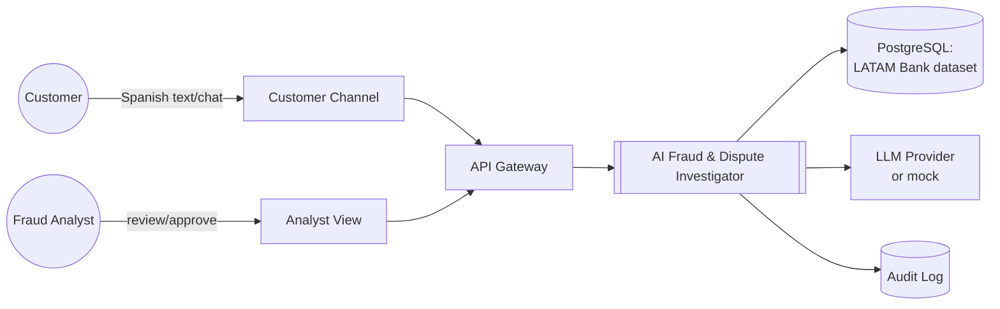
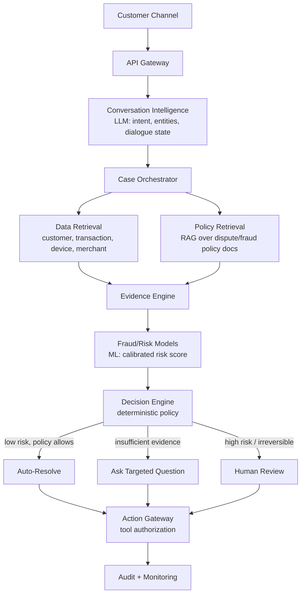

# Architecture

Owns: how the system is structured. See `docs/domain-model.md` for entities, `docs/
decision-policy.md` for the authorization logic, `docs/product-requirements.md` for what it's
for. Everything in this document is `PROPOSED` — nothing described here is implemented yet;
see `docs/project-status.md` for verified state.

## 1. System context



## 2. Component flow



## 3. Responsibility boundaries

This separation is the core architectural decision of the project (`prompt.md` § 3) and the
concrete expression of the core operating principle in `CLAUDE.md` § 2.

### AI (LLM) responsibilities

Natural-language understanding, intent classification, entity extraction, conversation state
management, question generation (paired with the deterministic Next-Best-Question gate, § 8),
summarization, policy-grounded explanation generation (grounded via RAG, never invented),
case summarization for human handoff, hypothesis generation, evidence synthesis narrative.

The LLM **proposes** — it never independently authorizes an action. Every tool call it
requests passes through the Action Gateway (§ 6).

### ML responsibilities

Fraud probability / calibrated risk scoring, anomaly detection, behavioral-deviation features,
transaction-risk features, merchant/device risk signals. Candidate models: logistic-regression
baseline, XGBoost/LightGBM main model, optionally an Isolation Forest for anomaly features
(`docs/model-evaluation.md`). ML produces a **score with a version**, not a decision.

### Deterministic responsibilities

Authentication/authorization checks, monetary limits, regulatory/reversibility constraints,
tool permission checks, human-approval requirements, action-risk classification
(`docs/decision-policy.md` § Action Risk Levels). These are implemented in code, not prompts —
see `docs/guardrails.md` § Enforcement Layers for why that distinction matters.

## 4. Data flow

Customer message → Conversation Intelligence extracts intent + entities (candidate
`transaction_id`, amount, date) → Case Orchestrator creates/loads a case → Data Retrieval pulls
the transaction (`transactions`), customer (`customers`), the customer's other recent
transactions and products (`products`), device/session signals (`digital_events`), and prior
complaints (`complaints`) → Evidence Engine assembles the evidence graph
(`docs/domain-model.md` § Evidence Graph) → Fraud/Risk Model scores the transaction using
features derived from retrieved data (never using the dataset's own `fraud_score`/`is_fraud`
directly as an input — see `docs/data-lineage.md` § Leakage) → Decision Engine applies policy
→ Action Gateway executes only authorized tool calls → Audit Log records the full provenance
chain (`docs/decision-policy.md` § Decision Provenance).

## 5. Evidence flow, policy flow, human-review flow, action flow

These four flows are one pipeline, described stage-by-stage in `docs/decision-policy.md`
(the canonical owner). This document only asserts the architectural boundary: Evidence Engine
output is immutable once written (append-only, provenance-stamped); the Decision Engine reads
it but does not mutate it; a human reviewer's decision is stored as a distinct record type
from the AI's recommendation (`docs/domain-model.md` § Human Decision vs. Policy Decision).

## 6. Tool system and action gateway

```
LLM → Tool proposal → Tool policy engine → Authorization check → Schema validation → Execution
```

Every tool (`get_customer`, `get_transaction`, `get_recent_transactions`,
`get_device_history`, `get_merchant_profile`, `get_fraud_signals`, `retrieve_policy`,
`create_dispute`, `freeze_card`, `notify_customer`, `create_human_review` — `prompt.md` § 16)
must have: schema-validated input, an authentication/authorization context, an audit log entry,
a timeout, a retry policy, and idempotency where the action can be retried safely. The LLM
never gets raw database access — every retrieval and mutation goes through a typed tool.
Tool-authorization detail and examples: `docs/guardrails.md` § Tool Authorization.

## 7. Storage, retrieval, orchestration

- **Storage:** PostgreSQL for all structured domain data (customers, transactions, products,
  cases, evidence, decisions), loaded from the LATAM Bank dataset. `pgvector` for policy-
  document embeddings (RAG).
- **RAG:** dispute policy, chargeback policy, cardholder agreement, escalation procedures are
  chunked, embedded, and retrieved (`prompt.md` § 18). If no reliable policy source is found
  for a claim, the system must say so or escalate — never let the LLM invent a policy.
- **Orchestration:** an explicit state machine (LangGraph or equivalent) drives the case
  through the pipeline in § 2, rather than an unconstrained agent loop — see
  `docs/decisions/README.md` for how to record this if it becomes an ADR-worthy choice later.
- **Events (optional, added only when a phase needs it):** `customer.message.received`,
  `case.created`, `transaction.retrieved`, `risk.assessment.completed`,
  `fraud.signal.detected`, `evidence.graph.created`, `human.review.required`,
  `action.approved`, `action.executed`, `case.resolved` (`prompt.md` § 4). A synchronous
  request/response path is sufficient for the MVP; introduce Kafka/Redpanda only if a specific
  phase requires decoupled, replayable processing — do not add messaging infrastructure
  speculatively.

## 8. Next-Best-Question (information gain)

The system must not ask questions whose answers are already known or wouldn't change the
decision (`prompt.md` § 20). Model this as: estimate the expected reduction in decision
uncertainty a candidate question would produce, weigh it against customer friction, and only
ask if the expected gain clears a (configurable, policy-owned) threshold. This is a
deterministic gate around an LLM-generated candidate question, not something the LLM decides
unilaterally — same authorization pattern as § 6.

## 9. Audit and observability

Every decision is auditable: input data snapshot, feature version, model version, model
output, evidence used, policy version, LLM recommendation, human decision (if any), action
taken, and result (`docs/decision-policy.md` § Decision Provenance; `docs/observability.md`).

## 10. Failure modes

| Dependency down | Fallback |
|---|---|
| LLM unavailable/timeout | Deterministic intent fallback (keyword/rule-based) → traditional fraud model still runs → escalate to human if the case can't be resolved without the LLM |
| Fraud/risk model unavailable | Fall back to a simpler baseline (logistic regression or rules) with a `model_degraded` flag on the decision record; never silently skip risk assessment |
| Database unavailable | Fail the request with a clear error; never approve a financial action without being able to read authoritative state |
| Vector DB / RAG unavailable | Answer only with retrieved, verifiable facts; state that policy could not be verified rather than letting the LLM improvise policy language |
| Malformed model/tool output | Reject and retry with backoff up to a bound, then escalate; never execute on unvalidated output |
| Kafka/event bus unavailable (if introduced) | Degrade to synchronous processing or queue for later with a dead-letter path; do not drop events silently |

General rules: timeouts and bounded retries with exponential backoff on every external call;
idempotency on every action with side effects; **never fail open** for an authorization-
sensitive or irreversible action — the safe failure is "ask a human" or "decline," not
"proceed." Full scenario-by-scenario detail: `docs/demo-script.md` (Scenarios E–L) and
`evaluation/golden_cases/`.

## 11. Idempotency

Actions with financial or state-changing effects (`create_dispute`, `freeze_card`,
`notify_customer`) require an idempotency key derived from the case and action type so a
retried or duplicated request cannot execute twice — tested explicitly (`prompt.md` § 45,
scenario "duplicate action request" in `docs/demo-script.md`).

## 12. Scalability

Design targets (**design targets — not measured**, per `docs/evaluation-plan.md` §
labeling rules): 10, 100, and 1000 cases/sec. Approach: stateless API layer for horizontal
scaling, async processing for anything not on the customer-facing latency path, caching for
repeated policy/reference lookups, database indexing on `customer_id`, `transaction_id`,
`case_id`, `timestamp`, `device_id`, `merchant_id` (`prompt.md` § 45), and an event-driven
path (§ 7) once volume justifies the added operational complexity. A local Docker Compose
environment is not production scale — this section describes how the design *would* scale, not
a claim that it has been load-tested.

## 13. Deployment model

Local: `docker compose up` running the API, PostgreSQL, and (optionally) a vector store and
Redpanda. No production deployment target exists or is authorized in this project
(`CLAUDE.md` § 7). AWS-compatible architecture is a stated target for how a real deployment
*would* look (`prompt.md` § 7), not something this repository deploys.

## 14. Security boundaries

Trust boundary detail lives in `docs/security-model.md`. Architecturally: the LLM sits inside
an untrusted-input boundary (customer text and LLM output are both untrusted); the Action
Gateway is the trust boundary between "what the LLM/customer asked for" and "what actually
executes"; the database is only reachable through the service layer, never directly from the
LLM or orchestration prompt context.

## 15. Technology rationale

- **FastAPI + Pydantic:** typed request/response validation is a hard requirement (§ API
  contracts), and async support matches the I/O-bound retrieval/LLM-call pattern.
- **PostgreSQL + pgvector:** one storage engine for both relational domain data and policy
  embeddings avoids operating two databases for a prototype of this scope.
- **Explicit state-machine orchestration over a free-form agent loop:** the decision pipeline
  (§ 2) has known stages with known authorization gates; an unconstrained agent loop makes it
  harder to guarantee the LLM can't skip the policy engine.
- **XGBoost/LightGBM over a deep model:** tabular fraud features, small-to-moderate data
  volume for training, and SHAP explainability are a better fit than a neural approach for
  this dataset and timeline.
- **Mock LLM mode as a hard requirement:** the project must be runnable, testable, and
  demoable without a paid API key or network dependency (`prompt.md` § 52).

- **Frontend: server-rendered Jinja2 templates + vanilla JS, no separate framework/build
  step** (Phase 10, resolving this section's earlier `OPEN QUESTION`). A React/Vue/etc. SPA
  would need a Node/npm toolchain running alongside Docker, Postgres, and the ML pipeline on a
  development machine already documented throughout this project as memory-constrained
  (`docs/project-status.md` § Known limitations); a prototype at this scope doesn't need a
  second language/runtime to get three views (customer status, analyst case detail, review
  queue) rendered. `src/api/ui.py` reuses the exact same request-handling functions
  `src/api/cases.py`'s JSON endpoints call — `Depends(...)` defaults are simply overridden with
  real values when called directly in Python — so there's one implementation per view, not a
  duplicated API-plus-frontend-client pair to keep in sync. See `src/api/README.md`.
